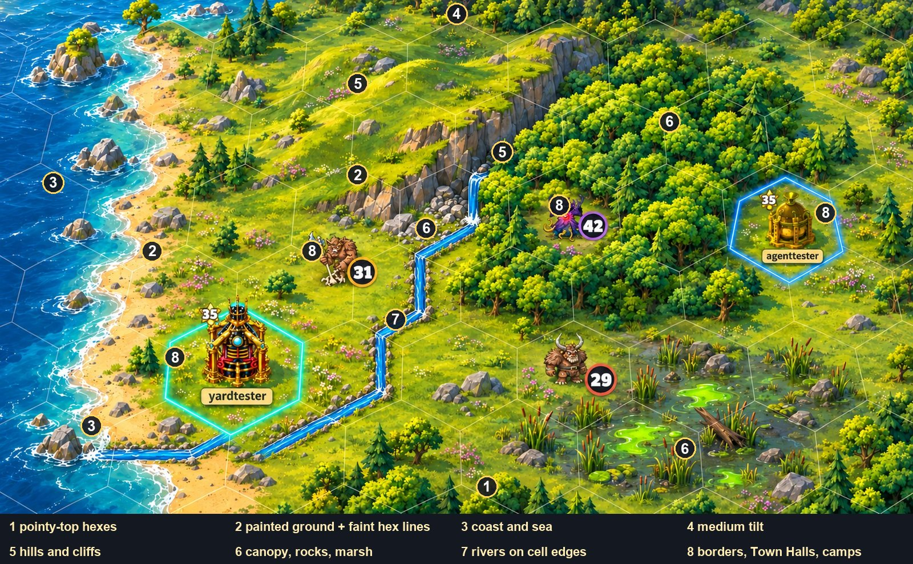

# Map Room 2, Modern look: the plan to reach mock-up B

Status: plan only. Branch `docs/mr2-look-plan`, rewritten 3 Nov 2026 by helper mr2-plan2 around the owner's
decisions of that morning (memory note `mr2-modern-look.md`). The first version of this plan (11 steps,
aimed at the older Codex mock-up) is in git history (commit 723c95458).
Baseline to go back to: tag `mr2-baseline-2026-11-03` (commit 6e2f6f41e).

## In short (for the owner)

The target is **mock-up B** (`worktrees/mr2-mockup2/art-samples/mr2-mockup2/variant-B-soft-lines.jpg`,
branch `docs/mr2-mockup2`): one continuous painted landscape seen through a tilted camera, pointy-top
hexes with faint lines, rolling hills and a rocky cliff, a solid forest, a goo marsh, a coast with surf,
a river on the cell edges, today's Town Hall / Outpost pictures with name tags, today's tribe portraits
with their level circles, and glowing borders round players' cells.

The plan gets there in **12 steps (0-11), about 33 helper-days, about 14-15 working days with 3 helpers**,
plus the owner's desk rounds. Every look step ends on the Review Desk with a real game screenshot beside
the same crop of mock-up B at the same scale, and an honest list of differences. All of it sits behind
switches: off = today's map; Classic always stays the Flash map. Honest estimate: after steps 1-10 the map
should look **about 85-90% like mock-up B**; step 11 (polish) is there to close the rest to 95%.

`art-samples/mr2-look-plan/plan-on-mockup.jpg`: mock-up B with the step numbers on the parts they build.

### The owner's rules this plan follows (3 Nov 2026)

- "95% like" mock-up B is THE target. Every look step shows a side-by-side (mock-up crop beside a real
  in-game shot at the same scale) with an honest list of differences.
- Two mock-up flaws are **not** copied: the river drawn as a narrow man-made channel (rivers must look
  natural, winding along the cell edges) and separate tree crowns (forests read as one solid canopy).
- One continuous painted landscape, no tile side walls; faint hex lines always shown (B strength);
  painted rolling hills and rocky cliffs; solid canopy forests, blended rock and goo marsh; no farm
  fields; player cells show their Outpost or Town Hall with name tags; tribe camps KEEP today's monster
  portraits and level circles; rivers along cell edges (look only); glowing borders round players' land
  only (yours cyan, alliance green, others blue, attackers red); real medium tilt at every zoom, opt-out;
  pointy-top hexes; no smoke.
- Behind a switch (off = today's map; revert = switch off; baseline tag `mr2-baseline-2026-11-03`);
  Classic always stays the Flash map; Quality High/Medium/Low; only the owner and lead see it until it is
  ready, then on for Modern players by a server switch that can be turned off again.
- Painted art comes from Codex (`codex exec` with mock-up crops as `-i` references), never Blender.
- Main yards get no land bonus (mr2-land). Tilt: MEDIUM (camera 32 degrees, far cells 66% of near),
  on by default in Modern, a player switch makes the map flat and is remembered for the account.

### What is already built, and what happens to it

| Branch (worktree) | What it has | Keep | Change | Drop |
|---|---|---|---|---|
| `feat/mr2-bonus5` (mr2-bonus5) | Neighbour bonus ladder +5/9/11/13/14/15%, painted shield chip in the pop-up and attack strip | All (approved) | Its neighbour count follows the pointy-top neighbours in step 1 | - |
| `feat/mr2-land` (mr2-land) | Land features (forest, rocks, marsh, nodes): rules, battle, income, `lf` in getarea, pop-up row and pictures; Codex trees/rocks drawn round each feature hex | Rules, server, `lf` data, pop-up row and its pictures | - | The map drawing (`landProps.ts`, `landSprites.ts`, the `features` layer in `MapChunk.ts`): it is single trees on flat-top hexes; step 6 repaints features as canopy in the new landscape |
| `feat/mr2-live` (mr2-live) | Moving water and shore foam, cloud shadows, far cloud banks, gulls, smoke | Cloud shadows, gulls, cloud banks (`SkyLayer.ts`), the live framework and Quality levels (`LiveMap.ts`, `liveLevel.ts`) | Water and foam (`WaterSheet.ts`, `WaterLayer.ts`) are per-hex frames for flat-top hexes: redone for pointy-top in step 1 (tile map) and moved into the painted coast in step 3 | Smoke (`SmokeLayer.ts`, `smoke*.webp`, its prompt) |
| `feat/mr2-tilt` (mr2-tilt) | Prototype: flat map drawn to a texture and laid on a `PerspectiveMesh`; pointer un-tilting; light/medium/strong; tests | All (`tilt.ts`, `TiltView.ts`, scene and input hooks) | Medium becomes the default, opt-out per account; the missing parts in step 4 | The light/strong choices from the player's view (kept in code for tests) |

---

## 1. Steps

Every step: behind the switches (section 4); Classic checked unchanged (and, after step 1, checked on
pointy-top); a real game screenshot from the yardtester world in the helper's own database copy beside
the same crop of mock-up B at the same scale (a near cell is about 300 px wide in the 2000 px mock-up;
the shot is scaled so its near cells match); an honest list of differences; High / Medium / Low shown when
the step adds art. One test browser at a time on the PC, opened only for the pictures.

| # | Step | What the player sees when it is done | Helper-days | Needs |
|---|---|---|---|---|
| 0 | Merge the waiting branches | Nothing new on screen (all switches off); bonus5's chip, land's pop-up row work as approved | 1 | Owner's go per branch |
| 1 | Pointy-top hexes (rules + today's tile map + Classic) | With the shape switch on, every map hex has a point at top and bottom; neighbours, range, takeover, neighbour bonus all follow; Classic shows Flash's own tiles cut to the new shape | 3.5 | 0 |
| 2 | Painted ground + hex lines + the look switch | One continuous painted ground (meadow with flowers, sand, rock, marsh mud, forest floor), faint cream hex lines over everything, no tile walls | 3 | 1 (HexGrid part) |
| 3 | Coast and sea | Turquoise shallows, deep blue sea, white surf breaking on a coastline that wanders across cells, sea rocks; water moves (mr2-live's water, redone) | 2 | 2 |
| 4 | Tilt, full version | Medium tilt at every zoom; portraits, badges, buildings and name tags stand upright; edges and zoom-out stop cleanly; minimap shows a trapezoid; an account switch makes the map flat | 5 | prototype merged (0); upright layer after 1 |
| 5 | Hills and cliffs | Ground swells into rolling hills with soft slope shading; rocky cliffs where the height drops sharply, following the land, grass over their top; height in the pop-up | 3 | 2 |
| 6 | Canopy forests, rock fields, goo marsh | Forests as one solid mass of treetops across cells, single trees only at the edge, small clearings where camps stand; rocky ground fading into grass; goo pools and reeds blending into the meadow | 3 | 2, land merged |
| 7 | Rivers on cell edges | Natural blue rivers winding along cell edges from high ground to the sea, soft rocky banks, a small waterfall where they leave a cliff | 3 | 1 (server half), 5 (falls) |
| 8 | Borders and markers on the painted map | Glowing borders round players' land (cyan / green / blue / red), Town Halls and Outposts with name tags, tribe portraits with level circles, domes and ticks, all sized to the new cells | 2 | 1, 4 (upright layer) |
| 9 | Far zoom and clouds | Zoomed out, the painted continent still reads (canopy, peaks, borders); painted cloud banks at the edge of sight fill the top of the tilted screen | 2 | 2, 3, 4 |
| 10 | Quality and speed | High / Medium / Low side by side; download sizes; frame times on the owner's kind of PC; the tilt redraws only on change; the scorecard | 2 | 2-9 |
| 11 | Polish to 95% | Fixes for the lowest-scoring parts of the scorecard, before/after for each; final scorecard | 3 | 10 |
| | **Total** | | **32.5** (call it 33) | |

### Step 0. Merge the waiting branches (1 day)

- **Order**: `feat/mr2-bonus5` -> `feat/mr2-land` -> `feat/mr2-live` -> `feat/mr2-tilt`, each into
  revamp with the owner's go and the `merge-approved` checks. All switches stay off, so players see no
  change.
- **Before merging**: on `feat/mr2-land`, a small commit takes the prop drawing out of `MapChunk.ts` /
  `MapRenderer.ts` (keep `landArt.ts` only if the pop-up pictures need it). On `feat/mr2-live`, a commit
  removes `SmokeLayer.ts`, the smoke art and its prompt, and its hooks.
- **Expected conflicts** (checked with `git merge-tree` against revamp be410ca27): bonus5 alone is clean;
  land after bonus5 conflicts in 6 files: `server/src/game-rules/combat/MANIFEST.json`,
  `web/src/game/combat/rules/MANIFEST.json` (re-run the manifest stamp), `web/src/api/types.ts` (keep both
  fields), `web/src/ui/maproom/CellPanel.ts` (keep both rows), `web/src/ui/styles/maproom.css` (keep both),
  `web/test/fixtures/defence-replay-mixed-waves.json` (re-stamp the replay; result must stay the same).
  `defence.ts` on both sides merges by itself; its tests must show the land and neighbour bonuses
  multiply. Live after land conflicts in `web/src/game/maproom/MapRenderer.ts` only (both add hooks; keep
  both). Tilt after all three is clean.
- **Check**: web and server test suites, typecheck, the golden defence replay; MR2 opened once with all
  switches off looks exactly like the baseline.

### Step 1. Pointy-top hexes (3.5 days)

Why early: the painted ground, the neighbour rules, range, clicking, the tilt's cell lookup, rivers and
borders all depend on the hex shape. Stored cell coordinates (x, y) do not change; which cells are
neighbours does. Nobody plays MR2 on the live server today (owner), so the change hurts no one.

- **The rule**: odd-r offset, pointy-top (odd **rows** shifted half a cell right), replacing today's
  odd-q flat-top. Axial: `q = x - (y - (y & 1)) / 2, r = y`. The world is 800 x 800 (both even), so the
  wrap keeps parity. Tribe camps stay `(x + y) % 4`; on odd-r a camp still has at most one same-tribe
  neighbour (now at (x-1, y+1) on even rows, (x+1, y-1) on odd rows), so the neighbour bonus numbers for
  camps stay the same; a test proves it.
- **One switch for the shape**: server `.env` `MR2_HEX_SHAPE=flat|pointy` (default flat = exactly
  today), sent with the map settings; the client sets the shape once when the map opens. Every rule and
  drawing reads it, so flat stays byte-for-byte today's game.
- **Files (checked by search, 3 Nov)**:
  - Server rules: `server/src/game-rules/maproom/range.ts` (`stepsBetween`), its mirror
    `web/src/game/maproom/rules/range.ts`, both `MANIFEST.json` and `sync.test.ts` in those folders;
    `server/src/services/maproom/v2/neighbourDefence.ts` (`mr2NeighbourCoords`),
    `server/src/services/maproom/v2/takeoverCost.ts` (`isAdjacentToMainYard`);
    `server/src/services/maproom/v2/rangeCheck.ts` (uses `hexDistance`; its square sweep still covers
    every cell in range on pointy-top, check by test); `server/src/controllers/maproom/v2/getArea.ts`
    (bonus5's neighbour count, via `mr2NeighbourCoords`).
  - Web geometry: `web/src/game/HexGrid.ts` (`toAxial`, `toOffset`, `neighbours`, `cellToPixel`,
    `pixelToCell`, `writeCellCorners`, `worldBounds`; a shape parameter instead of fixed odd-q),
    `web/src/config.ts` (cell size per shape), `web/src/game/maproom/attackRange.ts` (edge sides in
    `HexGrid.neighbours` order), `web/src/game/maproom/ground.ts` (`pickCell` with lift),
    `web/src/game/maproom/cellVisuals.ts` (hex width function near line 500, fog-edge test),
    `web/src/game/maproom/mapAtlas.ts` (hex outline and hole textures drawn from half/quarter width),
    `web/src/game/maproom/MapChunk.ts` (marker offsets from `CELL_HEIGHT`),
    `web/src/game/maproom/TerrainRaster.ts` (one texel per cell: shift odd rows, not columns),
    `web/src/game/maproom/chunks.ts` and `web/src/app/scenes/MapRoom2Scene.ts` (visible cell range:
    the margins of one column / two rows swap to two columns / one row), `web/src/game/maproom/RangeOverlay.ts`
    (follows `writeCellCorners`), `web/src/ui/maproom/Minimap.ts` (cell from pixel, approximate).
  - Today's tile art: `web/src/game/maproom/groundArt.ts` and the sheets `public/maproom/ground@2x.webp`
    (Flash) and `ground-painted@2x.webp` (Modern): a script in `web/tools/maproom-ground/` cuts Flash's own
    tile textures and cliff strip to the pointy-top shape (no new painting: Classic stays Flash's pixels).
  - mr2-live: `live/WaterSheet.ts` / `WaterLayer.ts` (foam frames per hex edge; pointy-top has vertical
    left and right edges instead of top and bottom ones).
  - Not affected, though a search for "flat" finds them: `web/src/game/yard/YardRenderer.ts` and
    `web/src/ui/yard/PlannerBar.ts` ("flat top-down view" of the yard planner). Map Room 1 and Map Room 3
    (`services/maproom/v3`) have their own grids and do not change.
- **Cell size**: today's tiles are 150 x 75 with a 3/4 view baked in. With pointy-top: the tile map
  (Classic and look-off) uses 150 wide, 100 tall, row step 75 (the same row step as today); the painted
  map (step 2) uses a top-down cell, about 150 x 150, row step 112.5, because the real tilt now does the
  foreshortening (150 x 150 at medium tilt looks about 150 x 127, close to mock-up B's near cells). Step
  2 fixes the final number against the side-by-side. The zoom tier numbers in `config.ts` (`LOD_*`) are
  re-tuned so the same number of cells is on screen at each tier.
- **Tribe groups (ON HOLD, Discord vote)**: if the vote passes, they slot in right after this step, in
  the same lane: camp layout in groups of 6-20 (Abunakki 1-6), and the camp half of the neighbour count
  becomes "camps of the same group". About 2-3 days; no look step depends on them.
- **Art**: none (Flash tiles are re-cut by script).
- **Check**: unit tests for both shapes: neighbours are symmetric, distance 1 = the six neighbours,
  wrap at the world edge, range sets match between server and web (`sync.test.ts`), takeover adjacency
  and the neighbour count agree with `HexGrid.neighbours`; picking: every point inside a drawn hex picks
  that hex. Screenshots: Classic and Modern tile maps on pointy-top beside today's flat-top; range overlay
  and takeover marks on pointy-top. No mock-up side-by-side (this step is shape, not look).

### Step 2. Painted ground, hex lines and the look switch (3 days)

- **Approach (kept from plan 1, section 2.1)**: one quad and one WebGL shader draws the ground for the
  visible world at every zoom, from a data texture of 800 x 800 cells (R height, G land feature `lf`,
  B river edge bits, A flags fog / not loaded / water). Per pixel it finds its pointy-top hex, reads the
  cell and its neighbours, picks the ground (meadow, lush meadow, sand, rock, marsh mud, forest floor,
  snow on the rare peaks), samples that ground's seamless texture in world position (neighbours of the
  same ground join with no seam), shifts the lookup by smooth noise so ground types wander across hex
  lines, and draws the faint hex lines by distance to the edge.
- **Hex lines, B strength**: light cream, about 30% opacity, 1-2 px on screen, over everything (canopy,
  hills, marsh, shallows), always on. Hidden only under rivers (step 7).
- **No walls**: no tile side walls, no cell columns; height shows only as shading (step 5).
- **Look switch**: `MR2_PAINTED_MAP=off|staff|on` (server `.env`; `staff` = owner and lead accounts
  only, by user id list), sent with the map settings; `off` = today's tile map. A local override
  (`bymr.mr2Look`) for development. Classic never loads the painted code. If the shader fails on a GPU,
  the map falls back to tiles by itself. The painted look needs `MR2_HEX_SHAPE=pointy`.
- **Files**: new `web/src/game/maproom/painted/` (ground shader, data texture, textures atlas); one
  choice in `MapRenderer.ts` at scene start; server map settings (where `MR2_LAND_FEATURES` is sent).
- **Art (Codex)**: seamless textures: meadow with tiny flowers, lush meadow, sand, rocky ground, marsh
  mud, forest floor, snow, plus a sheet of small grass decals (flower patches, tufts, pebbles). Mock-up B
  crops of each attached with `-i`.
- **Check**: unit test that switch off builds exactly today's chunk; shader compile fallback test;
  side-by-side of a meadow-and-beach area beside mock-up B's left-middle crop.

### Step 3. Coast and sea (2 days)

- Shallows turquoise near the shore deepening to deep blue, white surf where land meets water, a
  coastline that wanders across cells (from step 2's noise), sea rocks and small rocky islets near land
  (cell hash, same on every computer). mr2-live's moving water and foam are redrawn in the shader's coast
  (glints and foam scroll on High, half rate on Medium, still on Low).
- **Files**: `painted/` (coast in the shader, sea-rock sprites), `live/WaterLayer.ts` (on the painted
  look it draws only glints and foam).
- **Art (Codex)**: shallows and deep-sea textures, surf/foam strip, 6-8 sea rocks and islets.
- **Check**: side-by-side of a coast at near zoom beside mock-up B's left edge.

### Step 4. Tilt, full version (5 days)

Built on the merged prototype (`web/src/game/maproom/tilt.ts`, `TiltView.ts`). The prototype draws the
whole flat map into a texture each frame and warps it; pointer positions are un-tilted before the camera
and the hex rule see them, so picking already works and a new hex shape only replaces the last step.

- **Medium by default in Modern**, opt-out: a switch in the map's settings makes the map flat; remembered
  for the account (a new account setting on the server, like the privacy settings; today's Classic and
  sound choices are kept in the browser only). Classic is always flat.
- **Upright markers**: portraits, level circles, Town Halls, Outposts, name tags, domes, ticks and
  construction badges move out of the warped texture into a layer drawn on top, each placed at its
  cell's foot through the tilt and scaled by the local size, so they stand straight and do not squash.
  The rest of the map (ground, props drawn as sprites, borders) stays in the warped texture.
- **Camera edge limits** in tilted space; **zoomed-out view**: no empty band at the top of the screen
  (limit the zoom-out or fill with step 9's cloud banks); **minimap**: the view box drawn as a trapezoid.
- **Cell-pinned pop-ups** (hover card, cell panel anchor, takeover and range marks, bookmarks) placed
  through the tilt; **high-DPI** screens; **phone layout** (touch pan and pinch through the un-tilt).
- **Speed**: the flat texture is redrawn only when something changed (camera, chunk, animation tick of a
  visible layer), not every frame; Quality Low uses a lower-resolution texture (question 2).
- **Files**: `tilt.ts`, `TiltView.ts`, `MapRoom2Scene.ts`, `MapInput.ts`, `Camera.ts`, `ui/maproom/Minimap.ts`,
  `LabelLayer.ts`, `MapChunk.ts` (marker layer split, after step 1 merges), `ui/maproom/CellPanel.ts`
  anchoring, account settings (server controller + `ui/AccountSettings.ts`).
- **Art**: none.
- **Check**: existing `tilt.test.ts` plus tests for the upright layer position, edge limits and the
  minimap trapezoid; screenshots at three zooms tilted and flat, on a high-DPI and a phone-sized window;
  side-by-side of the near view beside the whole of mock-up B (far cells 66% of near on both).

### Step 5. Hills and cliffs (3 days)

- **Rolling hills**: the ground's shading follows a smooth height field (heights blended across cells,
  not stepped per cell), lit from the top-left, so hills swell over several cells with no walls.
- **Rocky cliffs** where the height between neighbours drops by more than a set amount: a painted cliff
  ribbon along a smoothed line between the high and low ground (it follows the land, not the hex lines),
  grass overhanging its top, scree at its foot (blends into step 6's rocky ground).
- **Snowy peaks** stay rare (185 m and up): peak pieces round the edge of the cell, camp spot kept clear.
- **Height in the pop-up**: a mountain-arrow icon and the number (e.g. "+48 m") in `CellPanel.ts`.
- **Files**: `painted/` (height field and shading in the shader, cliff ribbon mesh), `CellPanel.ts`.
- **Art (Codex)**: cliff face strip (tiling along its length, 2-3 variants), grassy overhang edge, scree
  patches, 2-3 peak pieces.
- **Check**: side-by-side of a hill with a cliff beside mock-up B's centre-back.

### Step 6. Canopy forests, rock fields, goo marsh (3 days)

- **Forest**: forest cells (mr2-land's `lf`) are painted as one solid canopy: a seamless top-down canopy
  texture in the shader over all forest cells, shaded so it bulges (rounded treetops, mixed light and dark
  greens, a few pines poking up as sprites), with single trees only along the outer edge where it meets
  the meadow. Camps on forest cells stand in a small clearing. Not separate tree crowns (mock-up flaw).
- **Rock**: rocky ground texture with boulder sprites fading into the grass, not stickers.
- **Marsh**: dark wet mud with bright goo pools and reeds, blending softly into the meadow.
- **Resource nodes**: mr2-land's node piles with a soft glow, kept small.
- **Files**: `painted/` (canopy and marsh in the shader, edge-tree and boulder placement); mr2-land's
  `lf` data. Not mr2-land's old `landProps.ts`.
- **Art (Codex)**: canopy texture (seamless, from above at the tilt), canopy edge strip, 6-8 edge trees
  and pines, rocky ground texture and boulders, marsh mud with goo pools, reed clumps.
- **Check**: side-by-side of the forest and the marsh beside mock-up B's right half; canopy must read as
  one mass at near and mid zoom.

### Step 7. Rivers on cell edges (3 days)

- **Look only**: rivers change no numbers (Classic and Modern play the same).
- **Server**: a river network built once from the world's height (`generateMap.ts` `getTerrainHeight`):
  sources on high ground by a seeded hash, each river running downhill along pointy-top cell edges to the
  sea. Sent as `rv` bits per cell in getarea (each cell's own three edges), like `lf`; switch
  `MR2_RIVERS`. No database change.
- **Client**: a ribbon along the edges with natural curves inside the edge band (wobble, wider
  downstream, soft rocky banks with grass), not the mock-up's straight channel; a small waterfall where
  it leaves a cliff (step 5); the hex line hidden under it.
- **Files**: server `services/maproom/v2/` (new rivers module, `getArea.ts`), web `painted/` river mesh,
  `api/types.ts`.
- **Art (Codex)**: river water strip (tiling), bank strip, waterfall (3-4 frames), river mouth.
- **Check**: server tests (always downhill, ends at sea, edges only, same on every run); side-by-side of a
  river from the cliff to the sea beside mock-up B's river, with the channel flaw named as an intended
  difference.

### Step 8. Borders and markers on the painted map (2 days)

- **Borders**: glowing lines round players' cells only, merged where one owner's cells touch: yours cyan,
  alliance green, others blue, attackers red; a soft haze inside the edge; slow pulse on High only.
  Tribe camps get no border.
- **Markers**: Town Hall or Outpost picture with its level star and name tag on player cells; today's
  tribe portraits and level circles on camps, sized to the new cell, standing upright (step 4's layer).
  Dome, truce tick, idle and construction badges kept.
- **Files**: `painted/` borders, `MapChunk.ts` / the upright layer, `cellVisuals.ts`.
- **Art**: none new (border glow drawn in code).
- **Check**: a mixed area (own, alliance, other, attacker, camps) beside mock-up B's yardtester and
  agenttester cells.

### Step 9. Far zoom and clouds (2 days)

- The painted ground shader also draws the far zoom (instead of today's one colour per cell): canopy,
  peaks, coast and borders still read; hex lines fade out.
- Fog cells (outside the player's sight) become painted cloud; mr2-live's cloud banks sit along the edge
  of sight and fill the far top of the tilted screen; cloud shadows and gulls kept on High.
- **Files**: `painted/`, `TerrainRaster.ts` (kept for the tile map), `live/SkyLayer.ts`.
- **Art (Codex)**: tiling cloud texture, 3-4 cloud banks (mr2-live has some already).
- **Check**: zoomed-out screenshots tilted and flat. Mock-up B has no far view, so this is judged on the
  desk by eye (owner's call), not by the 95% rule.

### Step 10. Quality and speed (2 days)

- High / Medium / Low per section 5's table; lazy download of painted art on first map open; frame times
  at each zoom measured on the owner's kind of PC with the in-game readout (not the headless browser).
- The scorecard: each part of mock-up B (ground, hex lines, coast, hills, cliff, canopy, rock, marsh,
  river, borders, markers, tilt) scored 0-100% on the side-by-sides, weighted by its share of the picture.
- **Check**: 3 Quality levels side by side; download sizes; frame times; the scorecard on the desk.

### Step 11. Polish to 95% (3 days)

Fixes for the lowest-scoring parts. Expected candidates (honest): grass detail density (mock-up B has
flowers and small rocks everywhere), the canopy's depth and shadow, hill roundness, cliff variety,
repetition visible at mid zoom, warmth of the light. Before/after for each fix; a final scorecard.

---

## 2. Lanes for 3 helpers

Helpers in parallel must not touch the same files. The hot files are `MapChunk.ts`, `MapRenderer.ts`,
`MapRoom2Scene.ts`, `HexGrid.ts` and `CellPanel.ts`; each lane below owns them in turn.

| Day | Lane A: rules and map core | Lane B: painted landscape | Lane C: tilt |
|---|---|---|---|
| 1 | 0 merges | Codex art batch for 2, 3, 5, 6 (textures are shape-free) | 4: account switch, edge limits, minimap (tilt files only) |
| 2-4 | 1 pointy-top (HexGrid + rules first, merged by day 2 so B and C build on it) | 2 painted ground (`painted/` only; uses the new HexGrid from day 3) | 4 continued: upright marker layer (after 1 merges), pop-ups, DPI, phone |
| 5-6 | 7 rivers (server first, then the ribbon) | 3 coast | 4 finished (speed: redraw on change) |
| 7-9 | 7 finished, then 8 borders and markers | 5 hills and cliffs | 6 canopy, rock, marsh |
| 10-12 | 10 quality and speed (measures 6 and 9 as they land) | 9 far zoom and clouds | 6 finished, then scorecard pictures for 10 |
| 13-15 | 11 polish (split by part across all three lanes) | 11 | 11 |

- **Merge order of the waiting branches**: bonus5 -> land (minus map props) -> live (minus smoke) ->
  tilt (switch off), all in step 0, before any lane edits `CellPanel.ts` or `MapRenderer.ts`. Expected
  conflicts are listed in step 0.
- **Clashes to watch**: step 1 and step 4 both touch `MapChunk.ts` and `MapRoom2Scene.ts`; lane C starts
  the marker layer only after step 1 is merged. Steps 5 and 6 both add to the ground shader: lane B owns
  the shader file, lane C adds canopy as its own shader include and texture, merged after step 5.
  Step 7's ribbon and step 5's cliff both draw over the ground: separate files in `painted/`.
- **Tribe groups**, if the vote passes, go in lane A right after step 1 (2-3 days), pushing steps 7 and 8
  back by that much.
- Desk rounds: one desk card per finished look step (2, 3, 5, 6, 7, 8) and one for the tilt (4); the
  lanes go on while the owner reviews.

## 3. Estimate (honest)

- **Helper-days**: 0 (1) + 1 (3.5) + 2 (3) + 3 (2) + 4 (5) + 5 (3) + 6 (3) + 7 (3) + 8 (2) + 9 (2) + 10 (2)
  + 11 (3) = **32.5, call it 33**. Tribe groups would add 2-3.
- **Calendar with 3 helpers**: about **14-15 working days** of helper time, plus desk rounds; with the owner
  reviewing every 1-2 days, about **3 weeks** end to end.
- **Likeness**: after steps 1-10, about **85-90%** of mock-up B. A rule-built map repeats where a single
  painting is hand-composed, so the last part is detail and variety, not structure. Step 11 must close:
  grass detail, canopy depth, hill roundness, cliff and rock variety, repetition, light. If the scorecard
  is still below 95% after step 11, the plan is another polish round on the lowest parts, not new
  features.
- **Not in the estimate**: the info card restyle from plan 1 (question 3), new tribe-camp art (the owner
  kept today's portraits), the old village art (dropped with the new target).

## 4. Switches and revert

- `MR2_HEX_SHAPE=flat|pointy` (server): the world's hex shape for every player, Classic included. Default
  flat = today.
- `MR2_PAINTED_MAP=off|staff|on` (server): the painted look for Modern players. `staff` = owner and lead
  only, until the owner says it is ready; then `on`. Off = today's tile map (on the current shape).
- `MR2_RIVERS`, plus the existing `MR2_LAND_FEATURES` and `MR2_NEIGHBOUR_BONUS`.
- Player: the tilt switch (account setting), on by default; Quality High/Medium/Low as today.
- **Classic always wins**: Classic never loads the painted code or the tilt. On pointy-top it shows
  Flash's own tiles cut to the new shape (question 1).
- **Revert**: switch the painted map off (players get the tile map at their next map open); for a full
  return to today, also set the shape back to flat. Nothing in the database changes with either switch
  (neighbour bonuses are frozen into each attack; takeover adjacency is checked at the takeover). Code
  baseline: tag `mr2-baseline-2026-11-03`.

## 5. Quality and download budget (kept from plan 1, adjusted)

| | High | Medium | Low |
|---|---|---|---|
| Ground | Full shader: blending, hill shading, decals | No decals | Lite shader: no edge noise, 3 texture reads a pixel |
| Ground textures | 512 px | 256 px | 128 px |
| Canopy edge trees and boulders per chunk (100 cells) | 600 | 300 | 120 |
| Animation | water, foam, river flow, waterfalls, border pulse, clouds, gulls | half rate, no gulls | none |
| Tilt texture | full resolution | full | half resolution (question 2) |
| Download (estimate, lazy on first map open) | 2.5-3 MB | about 1.2 MB | about 0.6 MB |

The tilt adds one extra draw of the whole screen into a texture; with redraw-on-change (step 4) it costs
nothing while the map is still.

## 6. Art list for Codex

Method (kept from plan 1): `codex exec` with mock-up B crops attached as `-i` references, one family per
call, sprites on pure magenta (keyed out), textures as seamless squares checked by rolling half a tile; a
`build.py` per kit cuts, keys, colour-matches to mock-up B and writes the High / Medium / Low copies.
Prompt header: "MATCH ITS ART STYLE EXACTLY: bright, painted, toy-like cartoon, saturated yellow-greens
and warm sandy yellows, crisp small painted details, warm sunlight from the top-left, seen from a tilted
top-down camera. Not photo-real. No text, no logos, no watermark, no hex lines, no grid." Never Blender.

| Family | Pieces | Step |
|---|---|---|
| Ground textures: meadow with flowers, lush meadow, sand, rocky ground, marsh mud, forest floor, snow | 7 | 2 |
| Grass decals: flower patches, tufts, pebbles | 9 | 2, 11 |
| Shallows and deep-sea textures, surf strip, sea rocks and islets | 10 | 3 |
| Cliff face strips, grassy overhang, scree, peak pieces | 9 | 5 |
| Canopy texture, canopy edge strip, edge trees and pines, boulders, marsh goo pools, reeds | 16 | 6 |
| River water strip, bank strip, waterfall frames, mouth | 7 | 7 |
| Cloud texture and banks (extra to mr2-live's) | 4 | 9 |

About 62 pieces (plan 1 had about 110; the village art is gone).

## 7. Risks

1. **95% may need more than 3 polish days** (a rule-built map repeats). Mitigation: variants, decals,
   the scorecard; another polish round rather than new features.
2. **Pointy-top touches rules**: range, takeover, neighbour bonus. Mitigation: one shape switch,
   tests for both shapes, server/web sync test; nobody plays MR2 live today.
3. **Classic on pointy-top** is no longer pixel-for-pixel Flash (question 1).
4. **Tilt speed on weak PCs**: redraw on change, half resolution on Low, the account switch.
5. **Upright markers vs the warped map**: markers drawn on top could hide things behind them at the far
   edge; sorted by the cell's distance.
6. **Merges**: steps 3 and 6 wait for mr2-live and mr2-land in step 0.

## 8. Questions for the owner (with a suggested answer)

1. **Pointy-top hexes change which cells are neighbours for every player, so Classic's map must turn
   pointy-top too. How should Classic look?** Suggested: Classic keeps Flash's own tiles, colours and
   portraits, cut to the pointy-top shape by a script (no new art), and turns pointy-top on the same day
   as Modern.
2. **Tilt on Quality Low: keep it at half resolution, or turn it off?** Suggested: keep it on at half
   resolution; players on slow PCs can still switch it off.
3. **The cell pop-up: restyle it as the earlier mock-up's wood-and-steel card now, or keep today's pop-up
   with the new height and land rows?** Suggested: keep today's pop-up for now (mock-up B has no card);
   the card restyle later as its own small job (about 1.5 days).
4. **If the new look has to be switched off after it is live, should the hexes also go back to flat-top?**
   Suggested: no, switch off the painted look only (players keep pointy-top on today's tiles, so
   neighbours do not change mid-season); the shape switch is only for a full return to today.

---

## Desk card draft

- **Title**: Map Room 2 Modern look: the build plan for mock-up B
- **What you will notice**: nothing in the game yet; this is the order in which helpers build the map
  you approved (picture with the step numbers on it), about 3 weeks with 3 helpers, with a side-by-side
  against mock-up B on the desk after every step.
- **Picture**: `art-samples/mr2-look-plan/plan-on-mockup.jpg`
- **Questions** (each with the suggested answer as the first button): questions 1-4 above.

Files: this plan; `art-samples/mr2-look-plan/plan-on-mockup.jpg`. Plan 1's art test
(`desk-main.jpg`, `side-by-side.jpg`, `compose.py`) is on flat-top hexes and is kept only as a record of
the texture method.
