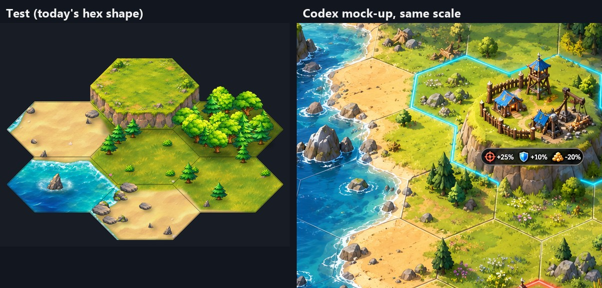

# Map Room 2, Modern look: the plan to reach the Codex mock-up

Status: plan only, nothing built. Branch `docs/mr2-look-plan`, written 3 Nov 2026 by helper mr2-look-plan.
Baseline to go back to: tag `mr2-baseline-2026-11-03` (commit 6e2f6f41e).

## In short (for the owner)

Today's Modern map is Flash's map repainted: every hex is its own flat tile with a monster portrait and a
level badge. The Codex mock-up is one continuous painted landscape (beaches, shallows, hills with cliffs,
forests, rivers, snowy peaks) with thin hex lines on top, small painted villages instead of portraits,
and glowing borders round players' land. The plan gets there in **11 steps, about 27 helper-days, about
2 weeks with 3 helpers**. Every step ends on the Review Desk as a real game screenshot beside the
mock-up at the same scale. The new look sits behind a **switch**: off, the map is exactly today's
Modern; Classic always stays Flash. The **art test** (below) shows the ground style is reachable: Codex's
painted grass, sand, turquoise shallows and sea, mr2-land's trees and a Codex hill, cut into 7 separate
hex tiles on today's grid, join with no seam. Honest estimate: the steps cover every element of the
mock-up, and after them the map should look **about 85-90%** like it. The last 5-10% is polish (more prop
variety, lighting, small decorations), which step 11 is for, judged on a scorecard on the desk.

| # | Step | What the owner will see on the desk | Helper-days | Runs in parallel? |
|---|---|---|---|---|
| 1 | Painted ground + the switch | One continuous painted ground (grass, sand, rock, snow, marsh, sea) blending across hex edges, thin hex lines, gentle hill shading; today's map with the switch off | 3 | First; art for 3 and 6 starts alongside |
| 2 | Coast | Turquoise shallows fading to deep blue, white surf on every beach, sea stacks and little islets | 2 | After 1 (with mr2-live merged) |
| 3 | Hills, cliffs, mountains | Raised grassy hills with rock cliffs, rocky hills, snowy peaks in ranges | 3 | Art from day 1; code after 1 |
| 4 | Dense forests, marsh, rocks | Forest hexes packed with trees spilling over edges, marsh with goo pools and reeds, boulder fields | 1.5 | After 1 and mr2-land merged |
| 5 | Rivers and waterfalls | Blue rivers running downhill along hex edges to the sea, waterfalls where they drop | 3 | Yes (server part any time) |
| 6 | Villages | Players' yards and outposts and the four tribes' camps as small painted villages; bigger with level; ruins when razed | 4 | Art from day 1; code after 1 |
| 7 | Reading the map | Glowing borders round players' land, a small chip under each village (level + who), in-range / protected cues | 2.5 | After 6 |
| 8 | Clouds and far zoom | Painted cloud banks at the edge of what you can see; the zoomed-out map as a painted continent | 2 | After 2 |
| 9 | Info card | The cell pop-up as the mock-up's card: one word, then icon + number rows, height badge | 1.5 | Yes, any time |
| 10 | Quality and speed | High / Medium / Low side by side; download sizes; frame times on Low; the full 3-picture scorecard | 2 | After 2-8 |
| 11 | Polish to 95% | Fixes for the lowest-scoring elements on the scorecard | 2.5 | Last |

Owner questions are in section 9 (five, each with a suggested answer).

### The art test

`art-samples/mr2-look-plan/desk-main.jpg` (test on today's hex shape beside the mock-up, same hex width)
and `side-by-side.jpg` (today's Modern map | test on today's hex shape | test with taller hexes |
mock-up). Pictures are git-ignored like all art samples, apart from these two sheets.

How it was made (`art-samples/mr2-look-plan/compose.py`, prompts in `work/*/prompt.txt`):
- **Codex, 5 calls, about 90 s each, the study's method** (section 6 of `docs/mr2-civ-study.md`, with the
  mock-up crops attached as style references): seamless grass, beach sand, turquoise shallows and deep
  sea textures, and one hill hex painted over a template of today's hex (150 x 75) on magenta. Codex
  kept the template's hex corners to within a few pixels.
- **Reused**: mr2-land's painted trees and rocks (`land-props@2x.webp`) and mr2-live's painted foam.
- **Put together the way the game would**: textures sampled in world position (so neighbours of the
  same ground join), the ground chosen by the cell under a noise-shifted point (so the beach wanders
  across hex lines), water depth from distance to land, a foam line on the shore, thin hex lines, sprites
  sorted by their foot, soft shadows from the top-left light.
- **Seamless check**: each of the 7 cells is saved as its own hex tile (`tiles/`), and the tiles pasted
  back together differ from the one-piece picture by **0** in every pixel, on both hex shapes.

How close it is, honestly:
- **Close**: the ground textures, the sea colours and surf, the trees and the hill's cliff are in the
  mock-up's style; at the same scale they could pass as parts of it.
- **Not yet**: (1) the mock-up's grass is busier: flowers, tufts, small rocks everywhere; ours is plainer.
  (2) Our hill is a neat hex column; the mock-up's is rounder and more ragged. (3) In only 7 hexes the
  beach still mostly follows hex edges; over a real coast the wander shows more. (4) Our hexes are
  flatter (150 x 75) than the mock-up's (about 220 x 150 at its scale); the taller-hex version in
  `side-by-side.jpg` is visibly closer (question 2). (5) No villages, borders or chips yet (steps 6-7).
- My rating of the ground alone: about 75-80% of the mock-up; the gaps are the ones steps 3, 4 and 11
  are for.

---

## 1. Every element of the mock-up, today, and the step that makes it

The mock-up is three pictures: 1 close view, 2 hex info card, 3 zoomed-out view
(`review-desk/img/mr2civ-compare-1..3.jpg`, left halves; full size in the mr2-civ-study worktree,
`shots/mr2-civ-study/codex/codex-1..3.png`). The "share" column is a rough share of the picture area,
used for the scorecard (section 7).

| # | Element in the mock-up | Share | Today (Modern) | Step | How |
|---|---|---|---|---|---|
| E1 | One continuous painted ground, thin hex lines over it | 26% | Separate flat tiles, each its own hex column with a dark edge | 1 | Ground shader (2.1) |
| E2 | Ground types blending across hex edges (beach wandering through hexes) | 5% | Hard tile edges | 1 | Warped cell lookup in the shader (2.1) |
| E3 | Busy grass: flowers, tufts, little rocks, bushes | 5% | Plain grass texture | 1, 11 | Textures + scattered decals (2.4) |
| E4 | Golden beaches with grey rocks at the waterline | 3% | Sand tiles | 1, 2 | Sand texture + waterline rocks (2.2) |
| E5 | Turquoise shallows, deep blue sea, white surf | 12% | Toned-down blue water tiles; mr2-live adds glints and foam | 2 | Shader depth + mr2-live foam (2.2) |
| E6 | Sea stacks and small islets | 2% | None | 2 | Props on sea cells near land (2.2) |
| E7 | Hills: raised grassy plateaus with rock cliffs | 6% | Flash's lift: a higher tile with a strip of cliff | 3 | Plateau + cliff sprites by height (2.3) |
| E8 | Snowy mountain peaks in ranges | 5% | Grey rock tiles (170 m and up) | 3 | Peak sprites on the highest cells (2.3) |
| E9 | Dense forests (pines and round trees) | 10% | mr2-land: trees round the hex's clear middle | 4 | mr2-land props, denser, + canopy texture far out (2.4) |
| E10 | Marsh: goo pools, reeds, dead trees | 3% | mr2-land: puddles and reeds | 4 | mr2-land props + marsh ground texture |
| E11 | Boulder fields | 2% | mr2-land: rock groups | 4 | mr2-land props |
| E12 | Rivers with waterfalls | 4% | None | 5 | River network from height, along hex edges (2.5) |
| E13 | Glowing coloured borders round owned land | 2% | A white ring on the viewer's own cell | 7 | Edge glow sprites (2.7) |
| E14 | Outposts and tribe camps as small painted villages | 6% | Monster portraits and Town Hall pictures | 6 | Village sprites by owner, tribe, level (2.6) |
| E15 | Dark stat chips under a cell (icons + numbers) | 1% | Round level badge, name plate; mr2-land and bonus5 add pop-up rows | 7 | Cell chip (section 3) |
| E16 | Glowing resource-node icons (picture 3) | 1% | mr2-land: resource piles | 4 | mr2-land node props + a soft glow |
| E17 | Cloud banks over the edge of the map | 6% | Flat grey/striped fog; mr2-live: clouds over the far map | 8 | Painted cloud banks on fog cells at the sight edge (2.8) |
| E18 | Tilted 3/4 view, warm top-left light, soft shadows | (all) | Same 3/4 art angle, little shadow | 1, 3, 11 | Baked into the art (2.9) |
| E19 | Info card: wood-and-steel frame, one word, icon + number rows, height badge | picture 2 | DOM cell panel; mr2-land adds a land row | 9 | Restyle of `CellPanel` (2.10) |
| E20 | Zoomed-out continent: tiny painted trees, peaks, territories readable | picture 3 | One flat colour texel per cell (raster) | 8 | The ground shader at far zoom (2.8) |
| E21 | (Not in a still picture) living map: water, smoke, gulls | - | mr2-live branch | - | mr2-live, unchanged |
| E22 | Small extras: wheat field, paths, fences round villages | 1% | None | 11 | Decals and village art |

Everything listed has a step. Nothing in the mock-up is left out on purpose.

---

## 2. Technical approach (Pixi 8, WebGL, today's chunks and zoom tiers)

Today (from the code): the world is 800 x 800 cells on an odd-q, flat-top grid, each cell 150 x 75 world
points, column step 112.5, row step 75 (`config.ts` `CELL_WIDTH/HEIGHT`, `game/HexGrid.ts`). Below zoom
0.22 the map is one texture with one texel per cell (`TerrainRaster.ts`); above it, 10 x 10-cell chunks
of sprites (`MapChunk.ts`): one ground tile per cell stood at its height (`ground.ts`, `groundArt.ts`),
a hairline outline, and the cell's marker (tribe portrait and badge, or Town Hall / outpost picture and
name plate). All the ground sprites share one layer sorted by paint order. `lod.ts` toggles layers by zoom
(glyphs from 0.30, portraits and badges from 0.55, labels from 0.90). Pixi is set to WebGL
(`App.ts` `preference: "webgl"`), so one GLSL shader is enough.

New code lives in `web/src/game/maproom/painted/` so today's path stays untouched (section 6).

### 2.1 Ground: one shader instead of a tile per cell (step 1)

- **Cell data texture.** `TerrainRaster` already writes one texel per cell as zones arrive. The painted
  look keeps a second 800 x 800 RGBA texture of *data*, not colour: R = height, G = land feature (`lf`
  from mr2-land), B = river edge bits (step 5), A = flags (fog / not loaded / water). 2.5 MB of video
  memory, uploaded at most once a frame, exactly as today.
- **One quad, one shader** covers the visible world at every zoom. Per pixel it finds its hex (the
  same maths as `HexGrid.pixelToCell`), reads that cell and its neighbours from the data texture, and:
  - picks the ground type from height + feature (deep sea < 80, sea < 100 with shallows near land,
    sand 100-109, grass 110-149, lush grass 150-169, rock 170-184, snow 185+, marsh/forest floor from
    `lf`);
  - samples that ground's **seamless painted texture in world position**, so same-type neighbours join
    with no seam (the art test's check: 0 difference);
  - **blends across edges**: the lookup point is shifted by a smooth noise (about a fifth of a hex), so
    beaches and meadows wander across hex lines as in the mock-up, then edges are softened;
  - **hill shading**: light from the top-left using the height difference to the neighbours;
  - draws the **thin hex lines** by distance to the hex edge (dark on land, pale on water), fading out
    at far zoom (today's `OUTLINE_MIN_ZOOM` rule).
- This replaces today's thousands of sorted ground sprites (2-3 per cell) with one draw, so it is
  cheaper than now on the CPU. On the GPU it is about 10 texture reads a pixel on High (section 5).
- **Ground textures** are in one atlas (10 tiling textures), painted by Codex with the mock-up crop
  attached, made seamless and colour-matched to the mock-up (as in the art test).
- **Picking and the camera are unchanged.** The ground is flat; only hills lift (2.3), and
  `ground.ts` `pickCell` already handles a per-cell lift.

### 2.2 Coast (step 2)

- **Shallows and deep water** in the shader: water cells next to land are shallow turquoise near the
  shared edge and deepen with distance (the neighbour read gives the distance inside a cell); open sea
  is deep blue. Colours taken from the mock-up.
- **Surf**: a bright foam line where the shader's land and water meet, plus mr2-live's painted foam
  (`live/foam@2x.webp`) moving over the shallows on High and Medium (mr2-live's `WaterSheet` stays the
  owner of animation; on the painted look it draws only foam and glints, not the water itself).
- **Sea stacks and islets**: props on sea cells within 2 of land, picked by a hash of the cell (same on
  every computer), with a foam ring; grey rocks along the waterline on sand cells.

### 2.3 Height: hills, cliffs, snowy mountains (step 3)

- Height stays the gameplay number it is today (range and income); this is only how it is shown.
- **Hills** (about 150-169 m): the cell's top is raised a little (about 20 points, like the art test)
  and **cliff pieces** are drawn along the hex's three front edges wherever the cell stands higher than
  the neighbour in front, as Flash's columns did but painted and ragged. Pieces: 3 edge directions x 2
  heights x 3 variants, plus grassy overhang tufts. Pick from a cell hash.
- **Rocky hills** (170-184 m): same, with rock tops and boulders.
- **Snowy peaks** (185 m and up, the rarest cells): 1-hex peak sprites, and 2-3 hex ridge pieces where
  peaks touch, so they read as a range. Every land cell holds a camp or a yard, so peaks stand round
  the edge of the hex with the middle kept clear (mr2-land's `inClearMiddle` rule): the camp sits in a
  mountain pass.
- Sorted with the trees and villages by foot, so a hill covers what is behind it.

### 2.4 Forests, marsh, rocks, grass detail (step 4)

- Built on mr2-land's `landProps.ts` (props round the clear middle, same on every computer) and its
  painted sheet. Changes: about twice the trees on High so forest hexes are packed like the mock-up,
  a few trees allowed over the edge into neighbours, a darker forest-floor texture, a **canopy texture**
  for far zoom (trees seen from above) so forests still read when single trees are hidden.
- Marsh: a marsh ground texture (mud and goo) under mr2-land's puddles and reeds; a few dead trees.
- Grass detail: scattered small decals (flower patches, tufts, pebbles, bushes) from a hash, drawn in
  the shader as stamps or as a few sprites per cell on High only.

### 2.5 Rivers and waterfalls (step 5)

- **Art only**: rivers change no numbers (Modern-only look; Classic and Modern must play the same).
- **Where they come from**: the server builds the river network once at start from the world's height
  noise (it can compute any cell's height, `generateMap.ts` `getTerrainHeight`): sources on high
  ground picked by a seeded hash, each river walking **downhill along hex edges** (between cells, as Civ
  V and the study's brief; every land cell has a camp or yard in its middle) until it reaches the sea or
  a lake. Since it always goes downhill, it never runs up a hill.
- **How the client learns them**: the server adds a small `rv` number to each cell in `getarea` (3 bits:
  the cell's own three edges, so every edge is stored once), like mr2-land's `lf`. No database column;
  same answer on every computer; works with fog (you only get rivers of cells you can see).
  Switch: `MR2_RIVERS=on` like mr2-land's `MR2_LAND_FEATURES`.
- **Drawing**: a ribbon mesh along the edges, smoothed and wobbled, widening downstream, with a tiling
  painted river texture that scrolls on High/Medium; **waterfalls** (animated 4-frame sprite) where the
  river drops a height band or meets the sea from a hill; a little delta at the mouth.

### 2.6 Villages instead of portraits (step 6)

- Each cell's marker becomes a small painted village drawn at the cell's middle (the clear middle mr2-land
  keeps free):
  - **Tribe camps**: Legionnaire, Kozu, Abunakki, Dreadnaut, each its own look (banners and colours,
    e.g. the mock-up's skull gate and purple tents), in 3 sizes by level (1-15, 16-30, 31+), and a ruined
    version for razed camps.
  - **Player main yard**: 3 sizes by Town Hall level (1-3, 4-7, 8-10), roofs in the relation colour.
  - **Outpost**: hut, harvester, tower, fence (the mock-up's), 3 sizes; the Starter Kit tint stays on
    the tower.
  - The protection dome, truce tick, idle-worker cue and construction badge stay, refitted to the
    village size.
- Every land cell holds a camp, so camps must be **small** or the map looks crowded, unlike the mock-up's
  open country (question 1): a camp is about a third of a hex; a player village about half.

### 2.7 Borders (step 7)

- Glowing borders round **players'** cells, merged where one owner's cells touch: for every owned cell,
  each of its 6 edges whose neighbour has another owner gets a glow-line sprite (additive, tinted by
  relation: own cyan as today's `OWN_COLOUR`, alliance green, others blue, attackers red). At most 6
  sprites a cell, built with the chunk. A faint tint inside. A slow pulse on High only.
- Tribe camps get no border (every land cell is one); their banner colour does the job (question 3).

### 2.8 Clouds at the sight edge and the far zoom (step 8)

- Fog cells (outside the player's sight, `Sight.ts`) become **painted cloud**: the shader draws a soft
  cloud texture on fog cells, and big cloud-bank sprites sit on fog cells next to seen ones, as in the
  mock-up's edges. mr2-live's drifting clouds stay on top on High.
- **Far zoom (raster tier, below 0.22)**: the same shader replaces the one-colour-per-cell texture, with
  hex lines off, the canopy texture for forests, rock and snow textures for mountains, and hill shading
  so ranges read. At the glyph tier (0.30-0.55) mountains and villages show as sprites, single trees do
  not.

### 2.9 The tilted 3/4 view: baked into the art, not a camera change

- The mock-up is an orthographic 3/4 view (hexes the same size at the top and bottom of the picture).
  Today's map is the same kind of view. So the tilt is **baked into the art** (trees, cliffs, villages
  drawn from 3/4, ground textures seen from above), and the camera stays a flat 2D camera.
- A real perspective camera (far hexes smaller) would need a projection mesh, break picking, LOD and
  chunk visibility, and is not in the mock-up. Not proposed.
- One real difference: the mock-up's hexes are taller for their width (about 0.68 against today's 0.5).
  Changing that for the painted look only is possible (a second `HexGrid` with row step 100; sizes that
  use `CELL_HEIGHT` and mr2-land's 37.5 must follow) but costs about 1.5 days and touches many files
  (question 2).

### 2.10 Info card (step 9)

- `ui/maproom/CellPanel.ts` (DOM) restyled as the mock-up's card in the Modern window skin (steel, from
  `feat/ui-skin`) with the wood title board: one word (the ground or feature name), then rows of one
  painted icon + one number (range, damage, health, income; mr2-land's land row and bonus5's neighbour
  chip feed them), and the height badge (mountain-arrow icon + "+48m"). The buttons (attack, scout, move)
  stay as today below the rows.

---

## 3. What players must still read at a glance

Portraits and name plates told players who is on a cell. The villages must keep that, with icons and
numbers rather than words:

| Players need | Today | Painted look |
|---|---|---|
| Who owns it | Portrait (tribe) or name plate (player), plate colour by relation | Village style (each tribe has its own), roof and border colour by relation; name plate stays at the closest zoom (label tier) |
| Its level | Round badge / gold star | **Cell chip** under the village: small dark rounded strip, [tribe emblem or relation icon] + level number, from the badge zoom (0.55) |
| Attackable or not | Dome (protected), tick (truce), range overlay | Same dome and tick, sized to the village; cells out of the player's attack range slightly faded when the range overlay is on (`RangeOverlay.ts`), as today |
| Razed camp | Faded portrait + cross | Ruined village (broken huts, smoke) + the same cross |
| The cell's bonuses | Pop-up only | Chip grows at close zoom (0.9+) to the mock-up's strip: land feature and height icons + numbers (mr2-land, bonus5) |
| Which monsters | Portrait | Hover card and pop-up keep the tribe portrait |

---

## 4. Steps in detail (order, deliverable, desk picture, days, lanes)

Every step: behind the switch; a real game screenshot (yardtester world, own database copy) beside the
mock-up crop at the same hex width; Classic checked unchanged; High / Medium / Low shown when the step
adds art. The single test browser is shared, so screenshots are taken in one short session per step.
No Blender is needed (all art is Codex painting).

Lanes for 3 helpers:
- **Lane A (map code)**: 1 -> 2 -> 8 -> 10
- **Lane B (art, then its code)**: Codex art for 3 and 6 from day 1 -> 3 -> 6 -> 7
- **Lane C**: 9 and the server half of 5 from day 1 -> 5 -> 4 (once mr2-land is merged) -> 11 (with all)

| Step | Deliverable | Desk picture | Days | Needs |
|---|---|---|---|---|
| 1 | `painted/` ground shader, data texture, 10 ground textures, hex lines, switch | Near and mid zoom beside mock-up picture 1; switch off = today | 3 | - |
| 2 | Shallows, surf, sea stacks, waterline rocks | A coast at near zoom beside the mock-up's left side | 2 | 1, mr2-live merged |
| 3 | Hill cliffs, rocky hills, snowy peaks (art + placement) | A hill and a mountain range beside the mock-up's hill hex and peak | 3 | 1 |
| 4 | Denser forests, canopy, marsh ground, grass decals | A forest and marsh beside the mock-up's right side | 1.5 | 1, mr2-land merged |
| 5 | Server river network + `rv`, river ribbons, waterfalls | A river from hill to sea beside the mock-up's river | 3 | 1 (client half) |
| 6 | 22 village sprites, placement, dome/tick refit | Each tribe and player village at 3 sizes, in game | 4 | 1 |
| 7 | Borders, cell chip, range fade | A mixed area: own, alliance, enemy, camps; beside mock-up picture 1 | 2.5 | 6 |
| 8 | Cloud banks, far zoom through the shader | Zoomed-out view beside mock-up picture 3 | 2 | 2 |
| 9 | Info card restyle | The pop-up beside mock-up picture 2 | 1.5 | - |
| 10 | Quality levels, sizes, frame times, scorecard | 3 pictures x 3 Quality levels; the scorecard | 2 | 2-8 |
| 11 | Polish the lowest-scoring elements | Before/after for each fix; final scorecard | 2.5 | 10 |
| | **Total** | | **27** | about 10-11 working days with 3 helpers |

---

## 5. Art list for Codex

Method: the study's (section 6) and the art test's: `codex exec` with the mock-up crops attached (`-i`)
as style reference, the same style header as `work/*/prompt.txt`, sprites on pure magenta (keyed out)
over a template of today's hex where shape matters (the test showed Codex keeps a template's corners),
textures as square seamless tiles then checked by rolling half a tile. One family of assets per call;
`build.py` per kit cuts, keys, colour-matches to the mock-up and writes the three Quality copies, as
mr2-land's and mr2-live's kits do. Sizes are in world points (a hex is 150 x 75); High = `@4x` only where
mr2-land already uses it, otherwise `@2x`; Medium and Low use the smaller copies in the table.

| Family | Pieces | Size (points) | High / Medium / Low | Step |
|---|---|---|---|---|
| Ground textures (seamless): meadow, lush grass, forest floor, canopy from above, sand, marsh mud, rock/scree, snow, shallows, deep sea | 10 | 256 x 256 tile | 512 / 256 / 128 px | 1, 4 |
| Grass decals: flower patches, tufts, pebbles, bushes | 12 | 10-25 | @2x / 1x / none | 1, 11 |
| Sea stacks, islets, waterline rocks | 9 | 20-60 | @2x / 1x / 1x | 2 |
| Cliff edge pieces (3 directions x 2 heights x 3 variants) + overhang tufts | 22 | 80 x 30-50 | @2x / 1x / 1x | 3 |
| Hill tops (grassy, rocky), peaks, 2-3 hex ridges | 14 | 60-200 wide | @2x / 1x / 1x | 3 |
| Extra forest/marsh props (dead trees, extra pines, reed clumps) to add to mr2-land's sheet | 8 | 20-40 | @4x / @2x / 1x (as mr2-land) | 4 |
| River texture (tiling along its length), banks, waterfall 4 frames, river mouth | 7 | 64-wide strip; falls 40 x 40 | @2x / 1x / 1x (still) | 5 |
| Villages: 4 tribes x 3 sizes + 4 ruins; yard x 3; outpost x 3 | 22 | 50-80 wide | @2x / 1x / 1x | 6 |
| Cloud banks and a tiling cloud texture | 7 | 150-400 | @2x / 1x / 1x | 8 |
| Info card: wood title board, height badge icon | 2 | UI | as UI skin | 9 |

Prompt style (all calls start with the art test's header): "MATCH ITS ART STYLE EXACTLY: bright,
painted, toy-like cartoon, saturated yellow-greens and warm sandy yellows, crisp small painted details,
warm sunlight from the top-left, seen from a tilted top-down camera. Not photo-real. No text, no logos,
no watermark, no hex lines, no grid." Then the one family, its layout on the sheet (grid of N on
magenta), and what to leave out.

---

## 6. Revert design

- **Code baseline**: tag `mr2-baseline-2026-11-03` (6e2f6f41e), as tagged by the lead.
- **Runtime switch** (so a revert is a switch flip, not a new release):
  - Server `.env` `MR2_PAINTED_MAP=off|on` (off by default, the pattern of `MR2_LAND_FEATURES` and
    `MR2_NEIGHBOUR_BONUS`), sent to the client with the map's settings. Flip and restart: every player
    is back on today's map at their next map open.
  - For review before it is on: a local override (`bymr.mr2Look` = `painted` / `tiles`) the lead and
    owner can set; not shown to players (no player picker, as the window style).
  - **Classic always wins**: with Classic on, the painted code is never loaded and the map is Flash's.
- **Code kept apart**: the painted look is `game/maproom/painted/*` plus one choice in `MapRenderer`
  at scene start ("tiles" = today's `groundArt`/`ground`/portraits, "painted" = the new layers). Today's
  files keep working unchanged; a unit test checks that with the switch off a chunk builds exactly
  today's sprites. If the shader fails to compile on a player's GPU, the map falls back to "tiles" by
  itself.
- **Data**: nothing in the database changes. `rv` (rivers) is computed and sent like `lf`; with its
  own switch off, no rivers are sent.

## 7. Performance and download budget

Today, at the badge zoom (0.55) a 1080p screen shows about 810 cells, about 2,700 at the glyph zoom
(0.30), 5,100 at 0.22; each cell is 2-5 sprites, and every ground sprite sits in one sorted layer.

| | High | Medium | Low |
|---|---|---|---|
| Ground | Full shader: blending, hill shade, decals | Shader without decals | "Lite" shader: no edge noise, no neighbour blending, 3 texture reads a pixel |
| Ground textures | 512 px | 256 px | 128 px |
| Props per forest cell | up to 20 | 10 | canopy texture + 3 |
| Prop sprite cap per chunk (100 cells) | 600 | 300 | 120 |
| Animation | mr2-live full, river flow, waterfalls, border pulse | mr2-live reduced, rivers half rate | none |
| Download (estimate, lazy on first map open) | about 2.5-3 MB | about 1.2 MB | about 0.6 MB |

- CPU: the ground drops from 2-3 sorted sprites per cell to one quad, so building a chunk gets cheaper;
  the props added are capped per chunk and hidden below the badge zoom (the canopy texture stands in).
- GPU: about 10 texture reads a pixel on High at 1080p is well inside integrated graphics; Low reads 3.
  No per-chunk render textures, so video memory stays small (data texture 2.5 MB + atlases).
- Step 10 measures frame time with the in-game readout (backtick) at each zoom tier and Quality on the
  owner's kind of PC, not in the headless test browser (it draws without the graphics card).
- **Scorecard for "95% similar"**: each element E1-E22 gets a 0-100% look score on the side-by-sides,
  weighted by its share (section 1); the target is a weighted 95%. Step 10 scores it; step 11 fixes the
  lowest.

## 8. Risks

1. **95% may need more polish than 2.5 days.** The mock-up is a one-off painting where every hex is
   hand-composed; a rule-built map repeats. Mitigation: many variants per prop, decals, the scorecard.
2. **Every land cell has a camp**, the mock-up shows open country. Small camps (question 1) or the map
   looks crowded.
3. **Players lose the monster portraits** they read the map by: tribe looks, chips and the hover card
   carry it (section 3); judge on the desk at step 7.
4. **Weak GPUs**: Lite shader on Low, automatic fallback to today's tiles if the shader fails.
5. **Art consistency over about 110 Codex pieces**: every call carries the mock-up crop; the lead vets
   full size before the desk.
6. **Merges**: steps 2 and 4 build on mr2-live and mr2-land; they wait for those branches to merge.
7. **Taller hexes** (if chosen) touch many constants and mr2-land's prop placement.
8. **Classic regressions**: Classic never loads the new code; checked at every step.

## 9. Questions for the owner (with a suggested answer)

1. **Every land hex has a tribe camp. Draw camps as small camps (a few huts and a tribe banner) and
   only players' cells as full villages?** Suggested: yes; camps grow a little with level (3 sizes) but
   stay about a third of a hex, so the land still looks open like the mock-up.
2. **Keep today's hex shape, or taller hexes like the mock-up?** (see `side-by-side.jpg`) Suggested:
   keep today's shape for steps 1-10 (cheaper, less risk), and try taller hexes behind the switch in step
   11 only if the scorecard says the shape is what holds it below 95%.
3. **Glowing borders round whose land?** Suggested: players only (own cyan, alliance green, others
   blue, attackers red), merged where one player's cells touch; tribes show their banner colour instead.
4. **Rivers: looks only, or should they change numbers?** Suggested: looks only (Classic and Modern must
   play the same).
5. **Who sees the new look, and when?** Suggested: only you and the lead (local switch) until step 10's
   scorecard; then on for all Modern players with the server switch, which also turns it back off.

---

Files: this plan; `art-samples/mr2-look-plan/compose.py` (the test, needs the mr2-land, mr2-live and
mr2-civ-study worktrees for its reused art; copy them in if those worktrees are removed),
`work/run.sh` and `work/*/prompt.txt` (the Codex calls).
